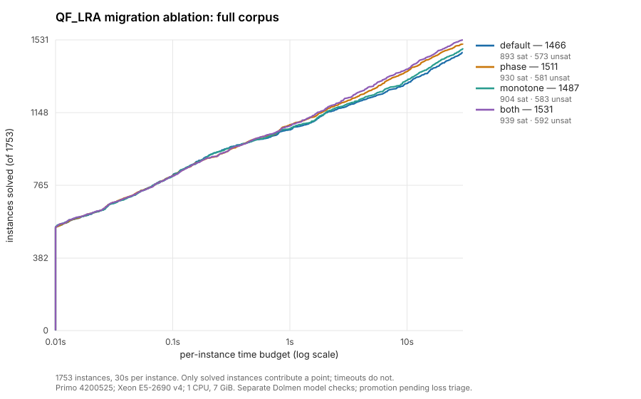
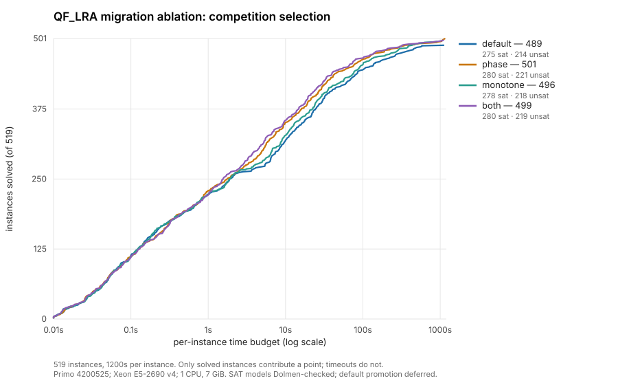
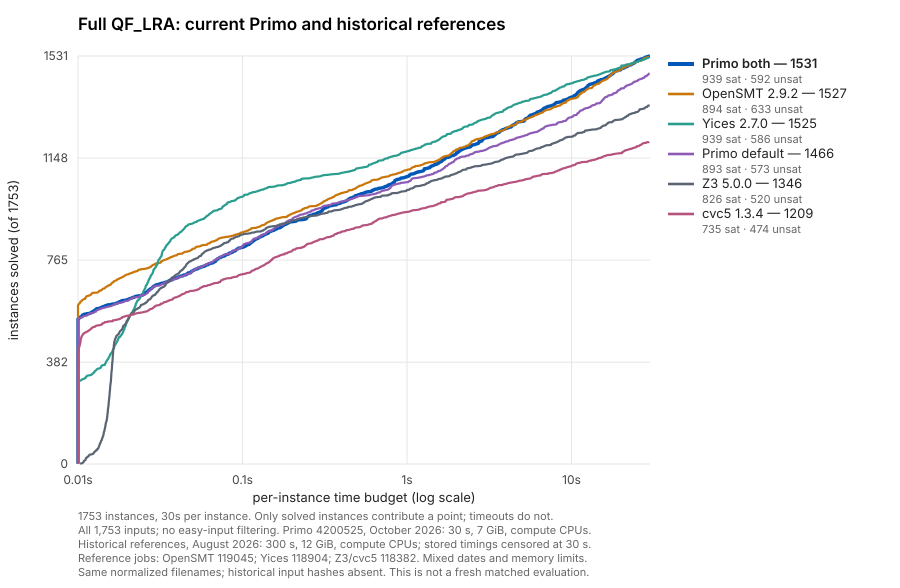
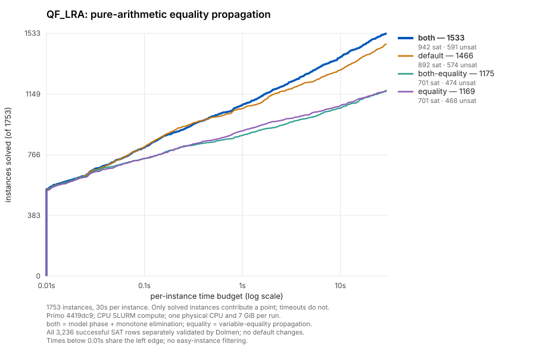

# Arithmetic engineering and retained evidence

Arithmetic development produced both implemented mechanisms and rejected
alternatives. The current [Real](../implementation/lra.md),
[integer](../implementation/lia.md), [preprocessing](../implementation/preprocessing.md),
and [combination](../implementation/combination.md) chapters own the algorithms.
This page records the associated decisions without treating historical timings
as current qualification.

## Mechanism and evidence map

H identifiers come from the original heuristics register; they are not API names.
All named run IDs below are in the {source}`run ledger <docs/run-log.json>`.

| Mechanism | Current explanation | Retained evidence and decision |
| --- | --- | --- |
| H1 direct bounds and shared polynomial rows | LRA preparation and normalization | {source}`H1 design and comparisons <docs/qf-lra-heuristics.md#L217-L340>` retain the incremental design progression; do not combine its differently configured promotion bars. |
| H2 small rationals | LRA exact-number representation | {source}`H2 ablation <docs/qf-lra-heuristics.md#L341-L439>` preserves the allocation motivation and measured comparison. |
| H3 sparse entering selection | LRA sparse pivoting and finite fallback | {source}`H3 investigation <docs/qf-lra-heuristics.md#L440-L538>` separates entering-variable sparsity from the optional leaving-variable choices. |
| H7 fixed-basic elimination | [Fixed-basic elimination](../implementation/lra.md#fixed-basic-elimination) | `2026-07-30-qf-lra-fixed-variable-elimination-h7`: the 595-file/60-second comparison did not justify pure-LRA promotion; row freezing was removed. The later `2026-08-08-convex-no-fixed-elimination-ablation-121439` concerns a different mixed route. |
| H8 sorted row merge | LRA sparse row update | `2026-07-31-qf-lra-h8-pivot-merge` and `2026-07-31-qf-lra-h8-scrambled-595`, `e6020ca`: accepted replacement of append/sort work. ASan has a separately recorded scope. |
| H9 bounds-only rollback | LRA backtracking; SOI exception | {source}`H9 evidence <docs/qf-lra-heuristics.md#L846-L876>` preserves its exact earlier baseline; basis and assignment need not be restored when bounds are undone. |
| H10 occurrence maintenance | LRA affected-row maintenance | `2026-08-01-qf-lra-h10-delta-occurs-in`, `aa44320` against `4f9b741`: 398→439 solved on 595 files at 60 seconds, +41/−0 within that comparison. Earlier unsuccessful occurrence structures remain in the old register. |
| H5 phase hints | [Model phase hints](../implementation/lra.md#model-phase-hints) | Initial local diagnostic and fuzz records are separate from `2026-08-26-lra-model-phase-monotone-promotion-test`, `3c2fbf1`; the full-corpus result differs substantially by logic. |
| SOI and its repairs | LRA objective, breakpoint walk and conflict explanation | {source}`arithmetic history <docs/arithmetic.md>` and {source}`paper deviation map <docs/papers/fast-linear-arithmetic-dpllt.md>` distinguish the optional algorithm from the default repair loop. |
| Integer patching, GCD, cuts and branching | LIA chapter and its [preservation map](../coverage/lia.md) | The original integer record retains the scaling/auxiliary/infinitesimal defects, mutation failures, and later repair gates; early clean random campaigns did not cover all real-seed shapes. |

## Different routes can justify different choices

At `3c2fbf1`, the model-phase/monotone comparison recorded 1,655 default QF_LRA
solves against 1,678 with model phase, with 34 gains and 11 losses. Mixed Real
results lost three solves with model phase. QF_LIA gained 178 and lost 137,
for a much smaller net gain. These are configuration-specific historical
results, not a universal speedup or a reason to change today's defaults.

Likewise, the H7 pure-LRA result does not determine its mixed-theory default.
Keep route, binary, input set, timeout and correctness coverage attached to
each conclusion. Historical local or incomplete-sanitizer checks remain such;
they are not rewritten as equivalent to later cluster gates.

## Combination evidence

The {source}`general-component migration record <docs/n-way-combination-migration.md>`
retains paired QF_UFLIA runs, family results, fuzzing and separate model checks.
The {source}`Real coordinator record <docs/nelson-oppen.md>` and
`2026-09-16-qf-uflra-forced-equality-extraction` / `...-forced-equality-merge`
retain their own revisions and comparisons. Generalizing the Real route remains
an open implementation lead, not a consequence of those evaluations.

The {source}`combination regression investigation <docs/nelson-oppen-qf-lra-regression.md>`
is a dated incident and diagnosis. It must not introduce the current chapter
as though the original regression were still an untriaged defect.

## Published results and unresolved provenance

The [published QF_LRA report](../papers/primo-qflra-results.md) preserves its
tables, cutoffs, hardware and configurations. Exact table-to-run mappings are
still missing. They belong in the [evidence work list](../work/evidence.md),
with the missing commit/manifest/command/artifact identities stated explicitly.
Matching a corpus size or option pair is insufficient to infer a run identity.

## Migration-branch option ablation

The October 10 recheck compares the migration implementation with both options
still off by default. Four profiles use the same binary: default, model phase,
monotone elimination, and both. The earlier October promotion on `main` measured
a different implementation and does not qualify this branch.

The full 1,753-instance corpus is the primary target for default selection and
regression assessment. Competition-selection results are supplementary; this
campaign does not select a competition portfolio. On the full corpus, both
flags together lead with 65 additional solved inputs and an 18.7% PAR2 reduction.

The {ablationsource}`driver <scripts/qualification/lra_ablation/run.py>` and
{ablationsource}`SLURM wrapper <scripts/qualification/lra_ablation/run.sbatch>`
record binary and input identities, exact arguments, CPU and allocation metadata. Generated answer/model
gates and tracked regression seeds precede timings. The timing sets are all
1,753 QF_LRA inputs at 30 seconds and the 519-input competition selection at
1,200 seconds. Each profile's successful SAT rows receive a separate direct
Dolmen replay; model checking does not contribute to runtime or PAR2.
Generated FuzzSMT model checks explicitly use the QF_NRA semantic superset for
constant-denominator syntax; real-corpus validation retains the original logic.

The fresh gates cover 4,000 generated cases per profile and 14,423 direct SAT
model checks across the profiles. Independent replay also covers all 3,922
retained mutations per profile. Dolmen and Z3 identify 399 of those inputs as
invalid: 314 have unbound identifiers and 85 contain forbidden nonlinear
arithmetic. These inputs are recorded by hash and excluded from pass counts;
timeout-only rows are also counted separately. The original failed replay jobs
and their diagnostics remain in the artifact trail.

The {ablationworkflow}`timing pipeline <scripts/qualification/lra_ablation/queue_followups.py>`
audited all four full-corpus profiles before starting
the competition selection. Both timing sets finished before model replay started.
Failed dependencies stop later stages, and a hard answer failure detected by the
{ablationworkflow}`guarded wrapper <scripts/qualification/lra_ablation/guarded.sbatch>` cancels its
timing array. Timing, model, selection-reference and paired-loss audits have
completed.

Both timing arrays and all separate SAT-model audits completed successfully on
the frozen `4200525` binary. The solver sources are equivalent to `df42f03`.
The measured results are:

| Profile | Full corpus solved, 30 s | Selection solved, 1,200 s | Full PAR2 reduction | Selection PAR2 reduction |
| --- | ---: | ---: | ---: | ---: |
| Default | 1,466 / 1,753 | 489 / 519 | — | — |
| Model phase | 1,511 / 1,753 | 501 / 519 | 13.7% | 29.3% |
| Monotone elimination | 1,487 / 1,753 | 496 / 519 | 5.2% | 19.1% |
| Both | 1,531 / 1,753 | 499 / 519 | 18.7% | 28.5% |

PAR2 reductions compare each profile with default at the same timeout. All
4,779 successful SAT rows across the two datasets passed direct Dolmen model
validation, with no answer disagreements among profiles. The selection also
matches the input hashes of the stored compute-node reference runs: OpenSMT
497 solved, Yices 489, Z3 476, and cvc5 471. All 28 pairwise joins among the
four native and four reference profiles have zero decisive disagreements.

The aggregate gains coexist with repeatable performance regressions. Relative
to default, the full run had 28 lost solves with model phase, 9 with monotone
elimination, and 23 with both. The
{ablationworkflow}`paired driver <scripts/qualification/lra_ablation/paired.py>` and
{ablationworkflow}`batch wrapper <scripts/qualification/lra_ablation/paired.sbatch>`
ran three repetitions of each lost solve on a single physical CPU per pair,
with alternating profile order and separate model replay. Full-corpus model
replay waited for its three paired timing arrays, independently of supplementary
selection reruns. The full-corpus losses classified as follows:

| Profile | Original lost solves | Lost in all three pairs | Did not repeat in two or more pairs |
| --- | ---: | ---: | ---: |
| Model phase | 28 | 24 | 4 |
| Monotone elimination | 9 | 6 | 3 |
| Both | 23 | 19 | 4 |

All 378 timing parents and their model coverage passed the
{ablationworkflow}`paired audit <scripts/qualification/lra_ablation/audit_pairs.py>`. The
127 additional successful SAT rows passed direct Dolmen validation; there were
no wrong answers, invalid models, or decisive answer disagreements.

These losses include substantial cliffs. On the full-corpus input
`latendresse/ecoliMILPglycerolYices3-5000.smt2`, default solved in about 8.5 seconds
in all three pairs while both flags timed out at 30 seconds. Supplementary
1,200-second reruns of that same input still timed out with both flags, while
default took about 8.7–9.3 seconds. This is a repeatable search regression,
not merely variation at the 30-second cutoff.

Both flags remain the best aggregate full-corpus profile, but default promotion
is deferred while these regressions are diagnosed. The measured profile remains
available explicitly; the campaign made no solver or default changes.

The [11 October regression investigation](lra-regressions.md) collected all four
profiles on the 33 distinct full-corpus losses and sampled eight representative
inputs. It locates costs in phase-induced arithmetic work, changed search after
elimination, and full-tableau violation-set reconstruction on backtracking.
It identifies follow-up experiments without changing or promoting either flag.

Run `2026-10-10-migration-lra-option-ablation` in the ledger records the completed
timings, complete model coverage and final loss classification. Options remain off by default.
The live ledger remains in use until the separate results-storage migration
is implemented.

### Full-corpus comparison with recovered references

The historical full-corpus reference CSVs are available: Z3/cvc5 job `118382`,
Yices `118904`, and OpenSMT `119045`. Each solver covers all 1,753 manifest
filenames at a 300-second limit. The earlier
{source}`reference cactus <docs/_static/qf-lra-cactus.svg>` hid 1,099 inputs
that every solver solved within 10 seconds; its legend therefore counts only
the remaining 654 inputs.

The following plot retains every input and overlays the current default and
both-option Primo profiles with the recovered references. Historical solves
after 30 seconds are censored in derived CSVs; original timing files remain
unchanged. At this cutoff, the counts are Primo default 1,466, Primo both 1,531,
OpenSMT 1,527, Yices 1,525, Z3 1,346, and cvc5 1,209.

This is a comparison with historical measurements: the references ran in August
with 12 GiB, while Primo `4200525` ran in October with 7 GiB. Both used the CPU
compute partition; recovered accounting places the reference tasks on
`node-01` through `node-06`. All eight profiles have identical normalized
filename coverage and zero decisive disagreements in all 28 pairwise joins,
including reference answers obtained after 30 seconds. The old campaigns did
not record per-input hashes, so byte identity is unverified. Current Primo SAT
models retain their separate validation; this recovery adds no reference-model
checks. Small count differences between Primo both, OpenSMT and Yices do not
establish a speed advantage under matched conditions.

Run `2026-10-11-qf-lra-historical-reference-recovery` records versions, resources,
artifact hashes, audit and plot commands. The
{recoveredreference}`CSV audit/censoring workflow <scripts/qualification/lra_ablation/reuse_references.py>` reads existing timings;
downloaded raw data
and derived CSVs are under `results/qf-lra-historical-references-20261011/`.

(pure-lra-equality-portfolio-evidence)=
## Pure-LRA equality propagation experiment

The October 21 experiment adds the default-off
[`--lra-equality-propagation`](#experimental-pure-arithmetic-equality-propagation)
configuration for diversification. It applies the existing model-unit equality
recognizer to comparisons already in a pure QF_LRA input. The paper explicitly
disables this discovery pass for pure arithmetic; this experiment changes that
scope rather than attributing the setting to its authors.

All four profiles use the frozen `4419dc9` binary and the same hashed 1,753
inputs, with 30 seconds per input, one physical CPU and 7 GiB on SLURM compute
nodes. No GPU nodes or competition subset are used. Here **both** means
`--lra-model-phase --monotone-elimination`; **equality** means the new flag.

| Profile | Solved | SAT | UNSAT | Timeouts | PAR2 sum, seconds |
| --- | ---: | ---: | ---: | ---: | ---: |
| Default | 1,466 | 892 | 574 | 287 | 21,262.3 |
| Equality | 1,169 | 701 | 468 | 584 | 37,381.9 |
| Both | 1,533 | 942 | 591 | 220 | 17,185.0 |
| Both + equality | 1,175 | 701 | 474 | 578 | 37,515.8 |

The timing audit finds no wrong answers, errors, unknown results or decisive
disagreements among profiles. Every successful SAT row passed separate direct
Dolmen model replay: 892 default, 701 equality, 942 both, and 701 both/equality,
for 3,236 checks in the original input logic. All timing tasks finished before
model replay started; checking time does not enter the table or cactus.

Equality has three gains and 300 losses against default. Both already solves
all three gains. Adding equality to both has zero gains and 358 losses. The
default/both union is 1,556, and the four-profile union is also 1,556: this run
shows no extra solved coverage from the new configuration. These unions allow
30 seconds **per configuration**; they do not measure a portfolio scheduled
within one shared 30-second budget. Equality raises PAR2 by 75.8% against
default; adding it to both raises PAR2 by 118.3% against both.

Exploratory censoring of the same timing rows finds small coverage gains at
shorter cutoffs. No extra solver runs or portfolio scheduling were performed:

| Cutoff per configuration | Default/both union | Four-profile union | Extra inputs |
| --- | ---: | ---: | ---: |
| 0.1 s | 830 | 830 | 0 |
| 1 s | 1,101 | 1,101 | 0 |
| 3 s | 1,238 | 1,238 | 0 |
| 5 s | 1,301 | 1,302 | 1 |
| 10 s | 1,396 | 1,398 | 2 |
| 20 s | 1,501 | 1,501 | 0 |
| 30 s | 1,556 | 1,556 | 0 |

For example, equality solves the Bradley--Manna--Sipma LassoRanker
`Iteration1_Lasso_7-phaseTemplate` input in 8.36 seconds, versus 19.06 for
both and a default timeout. Its other ten-second addition is
`2019-ezsmt/routingMax/SCC_strong/p50.56.smt2`, at 7.66 seconds versus
13.60 for both. These observations have no paired-repeat confirmation and
do not establish a useful schedule under a shared budget.

The largest losses are in LassoRanker: default solves 236 and equality 63,
while both solves 296 and both + equality 71 of its 419 inputs. Other affected
families include `2019-ezsmt` (90/61 and 94/67), `sc` (144/116 and 144/107),
and `uart` (70/32 and 66/31), with each pair showing the profile before/after
enabling equality. All 488 meti-tarski inputs remain solved in every profile.

A separate diagnostic on
`2019-ezsmt/travellingSalesperson/rand_70_300_1155482584_11.lp.smt2` locates
the cost in equality discovery. In a five-second counter run, equality spends
4.56 seconds in 13,443 scans, returning 4,304,669 explained edges but delivering
only three target literals. A separate GDB run samples the equality consumer
in 151 of 155 stacks and its tableau producer in 132. These are overlapping
inclusive counts from an instrumented run, not replacement benchmark times.
Repeated scans and unproductive discoveries explain this case's overhead;
the counters do not establish a general search or pivot pathology.

Correctness qualification also passed 44 release and 44 ASan CTest targets,
242 Python tests, 12 documentation examples, and 18 original seeds in each
profile. Each profile received 3,000 generated FuzzSMT cases and 1,000
Boolean/arithmetic cases. Across the status-aware FuzzSMT replays, 83
timeout-only outcomes are separate from passes. There were 14,389 generated
SAT-model checks; those from FuzzSMT use the QF_NRA semantic superset for
constant-division syntax. Fresh real-seed OpFuzz campaigns produced no bug
triggers, and independent replay passed all 3,600 retained files per profile
(1,652 distinct contents). Equality-only retained mode passed 1,000 sessions,
11,000 queries and 8,000 direct SAT-model checks. The initial combined-profile
assumptions probes hit the existing monotone-elimination configuration guard;
that unsupported combination is recorded separately, not counted as a pass.

The {equalityworkflow}`campaign driver <scripts/qualification/lra_equalities/campaign.py>`,
{equalityworkflow}`complete-coverage audit <scripts/qualification/lra_equalities/audit.py>`,
and {equalityworkflow}`diagnostic plan <scripts/qualification/lra_equalities/diagnostic-plan.json>`
preserve the profiles and method. Run `2026-10-21-pure-lra-equality-portfolio`
records the exact binary, input identities, resource limits, jobs and raw
artifacts under `results/lra-equality-portfolio-20261021/final/`.
The flag remains an experimental control; defaults are unchanged, and this
measurement supplies no positive portfolio-coverage evidence at 30 seconds.
The small exploratory gains at shorter cutoffs remain distinct from the
aggregate losses and the absence of a measured shared-budget schedule.

Rejected prototypes and unimplemented H4/H6/H11 directions remain discoverable
through the [research register](../leads/index.md). Keeping their negative
results prevents a later proposal from mistaking an already rejected design
for an untested idea.
