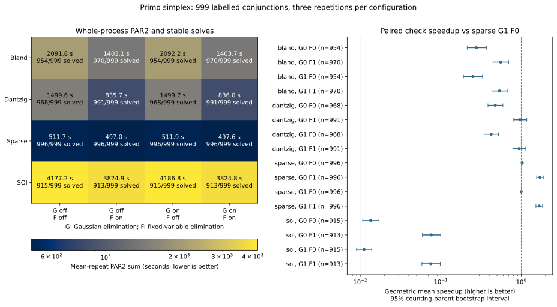
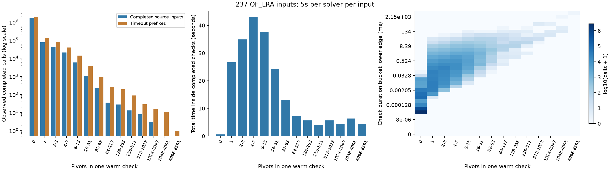

# QF_LRA call distribution and conjunction extraction

**Status: A 1,000-input conjunction corpus is frozen, with 999 verified labels
and one unknown research candidate.** Work is isolated on `experiment/qf-lra-call-ablation`.
This note defines the measured call, records its pivot/time distribution, and
provides frozen inputs for the next ablation stage.

## What constitutes a call?

The dedicated rebuilt QF_LRA online path retains a tableau across the SAT trail.
At a quiescence point, `OnlineLraPropagator::run_deferred_check_if_needed` calls
`LraTableau::check()` to repair the assignment or find a numerical conflict.
The observer measures that episode, not the entire SMT input, not every bound
assertion, and not a solver rebuilt from scratch on the current conjunction.

For each completed episode, record checker/call IDs, the pivot-counter delta,
steady-clock nanoseconds, row-update and row-term-operation deltas, and whether
`check()` returned a conflict. These are **warm** measurements: basis,
assignments, elimination state and previous assertions can influence the work.
The timer surrounds only `check()`; logging and export happen afterwards.
Clock resolution matters for very short zero-pivot calls, and the surrounding
observer can still perturb caches and which calls a wall-limited run reaches.
Instrumented whole-input times are not a performance comparison.

Immediate contradictory-bound rejections, assertion-time elimination pivots,
propagation scans, equality probes, final model reconstruction, mixed-theory
components and retained assumptions engines are outside this first observer.
A source may also finish during preprocessing. Such inputs remain in the
source-input denominator with no recorded calls, rather than disappearing.

## Ownership, lifetime and trace completeness

`CheckSatOptions` holds a shared pointer to `LraCallProfiler`, whose single
output stream and export budget span sequential queries in one process.
The dedicated online propagator registers its base tableau and owns the returned
checker descriptor. It passes const tableau queries to the recorder; no
assertion, pivot, term or SAT literal is created by the observer. Other online
propagator constructors use the null default and remain uninstrumented.

The JSONL stream has `begin`, `checker`, completed `check`, and `end` records.
An end record counts all registered checkers, completed calls and exported files.
Normal completion flushes the stream. An end marker alone is insufficient:
require command success, no diagnostic errors, and agreement between checker/
call events, their sequence numbers and terminal counts. Error unwinding may
close a stream after an export failed; such count mismatches are invalid evidence. During search, flush after every 1024
completed calls; a killed process may omit an unfinished call and buffered tail.
Treat a missing end or partial final line as a **censored prefix**. Its observed
maximum pivot count is not a bound on the uncompleted call, and a timeout is
not a completed long-duration observation.

The implementation owners are
{callsource}`the options <src/smt/check_sat.hpp>`,
{callsource}`the CLI <src/main.cpp>` and
{callsource}`the online callback <src/smt/solver_engines.cpp>`.
The {callsource}`diagnostic helper LraCallProfiler <src/smt/lra_call_profiler.cpp>`
owns serialization and export budgets.
The caller retains shared ownership until all callbacks have been destroyed.

## Capture before a potentially interrupted check

The completed-call exporter misses a check that never returns. An opt-in
`--lra-call-capture DIR` therefore saves the selected call of the **first
registered checker**, before entering `check()`. `--lra-call-capture-call N`
chooses a positive one-based call number; the default is 1. The existing
profiler owns the directory string, target number and an attempt flag, so it
serializes at most once per process. It snapshots the same base equations and
current bounds as a completed export, with `:status unknown`; it captures no
basis, assignment or reason graph. No signal handler accesses tableau state.

The writer closes a temporary file in the destination directory and renames it
to `capture.smt2`, then flushes a `capture` event with checker/call IDs. A kill
before publication can leave no file or a temporary file, possibly complete;
a kill between
publication and event flushing leaves an unannounced snapshot. Neither is
classified as an interrupted check. Serialization and event flushing precede
the numerical timer. This one-call selection avoids serializing millions of
cheap checks merely to reach a later hard call.

Capture mode uses trace schema 2; ordinary completed-call profiling keeps
schema 1. If the selected call returns, its ordinary `check` record is flushed
immediately. The analyzer joins capture and completion IDs, independently of
file presence or an `end` marker. A published, announced capture without a
durable completion remains a **provisional no-completion candidate**. It does
not establish SAT/UNSAT, elapsed check time, or that every moment before process
termination was spent inside `check()`: entry and postcheck logging/export can precede durable completion.
A separately replayed conjunction can behave differently from the interrupted
warm state. Reference answers and successful SAT models must be checked before
assigning an expected verdict; timeout-only replays remain unknown.

The next bounded probe selects the nine original five-second timeout inputs
that registered a checker but recorded zero completed calls. All are from
`latendresse`; their first-check captures directly test the missing tail. Four
other zero-call timeouts never registered a checker and need separate frontend
triage. This is a targeted development sample, not all 66 timeout parents.
Runtime qualification and the targeted probe are complete; results follow.

### Results of the selected-call timeout probe

The ten-second parent pass recovered **nine distinct published, announced
snapshots**: **five without durable completion records** and four whose selected
checks completed. All five no-completion captures came from MILP glycerol
parents with suffixes `60000`, `80000`, `90000`, `100000` and `300000`.
Seven parent processes timed out overall; one finished SAT and one UNSAT.
One successful SAT-parent model passed a separate direct Dolmen check.
The four completed captures show why zero durable calls in the earlier trace
were a selection hint, not proof that the first numerical check was stuck.

Fresh replays used the same qualified `d4944eb` binary and production defaults,
with one physical CPU and 8 GiB per task on node-09. Limits were **60 seconds
per native or reference process**. Eight native replays finished SAT, each with
exactly one completed numerical check. Their pivot range is **868–4,879** and
their numerical-check time range is **0.431–14.510 seconds**.

| Parent suffix/name | Selected warm call | Fresh native result | Completed pivots | Check time (s) |
| --- | --- | --- | ---: | ---: |
| MILP `5000` | completed | SAT | 1,463 | 2.446 |
| MILP `60000` | no durable completion | SAT | 2,115 | 7.400 |
| MILP `70000` | completed | SAT | 3,676 | 10.936 |
| MILP `80000` | no durable completion | SAT | 3,633 | 10.864 |
| MILP `90000` | no durable completion | SAT | 3,655 | 11.138 |
| MILP `100000` | no durable completion | SAT | 4,879 | 14.510 |
| MILP `300000` | no durable completion | overall timeout | unknown | unknown |
| `shewanella-compact2` | completed | SAT | 868 | 0.432 |
| `shewanella-compact2b` | completed | SAT | 868 | 0.431 |

The `300000` conjunction timed out in **both Primo and Z3 at 60 seconds**.
It remains an **unknown-status research candidate**. These are whole-process
timeouts: no completed numerical duration or pivot count is assigned to it.
The four completed warm-call verdicts agree with decisive fresh outcomes.
In particular, the parent that ultimately returned UNSAT supplied a SAT
prefix conjunction; the parent answer must not label an individual call.

All **eight native SAT models** passed native `--check-model` and direct Dolmen
validation under the unchanged QF_LRA annotation. Z3 returned SAT on two inputs
and timed out on seven; both of its SAT models also passed direct Dolmen checks.
Validation ran after timing, with exact input hashes and command-adapted
assertion text checked. There are no disagreements, invalid models or missing
successful-SAT model checks. Native timing and model stages did not overlap;
source-parent model jobs ended before fresh timing began, as confirmed by
SLURM accounting.

The frozen input files keep their original `:status unknown` bytes, preserving
the measured hashes and capture provenance. **Eight SAT labels live in an
independent expected-status map; one entry remains unknown.** Future ablation
runs must pass that map through
{capturebench}`the harness <scripts/run_lra_call_distribution.py>`'s
`--expected-statuses FILE` option (or `PRIMO_CALL_EXPECTED_STATUSES` in
{capturebench}`the batch wrapper <scripts/slurm_lra_call_ablation.sbatch>`). This makes a wrong
answer fail even if the reference solver times out, without altering the saved
conjunction. Conflicting known labels in SMT-LIB and metadata are rejected.

- {capturebench}`All nine snapshots <benchmarks/qf-lra-captured-calls/manifest.txt>`.
- {capturebench}`Eight independently proven SAT inputs <benchmarks/qf-lra-captured-calls/manifest-known.txt>`.
- {capturebench}`One unresolved candidate <benchmarks/qf-lra-captured-calls/manifest-unknown.txt>`.
- {capturebench}`Expected statuses <benchmarks/qf-lra-captured-calls/expected-statuses.json>` and
  {capturebench}`classification, proof joins and per-input measurements <benchmarks/qf-lra-captured-calls/classification.json>`.
- [Fresh numerical-check report](../coverage/lra-captured-fresh-20261030.json) and
  [historical submission arguments](../coverage/lra-capture-jobs-20261030.json).

{capturebench}`scripts/collect_lra_call_captures.py` excludes missing or
unannounced snapshots and deduplicates the saved bytes.
{capturebench}`scripts/qualify_lra_call_captures.py` joins native and reference
SAT models to the exact captured assertions, checks completed warm-call
verdicts against fresh outcomes, and writes the known/unknown manifests and
expected-status map. Source capture and fresh replay remain separate states.
This small, single-family development sample supports the value of retaining
interrupted calls; it does not establish a representative ablation distribution.

The native snapshot passed 44 release and 44 ASan CTest groups, 247 Python tests,
12 documentation checks and 1,000 generated cases with **capture enabled** for
every solver invocation. The whole-tree 133-translation-unit scan matches all
current C++ source hashes. Two additional offline metadata tests cover applying
known labels to unknown-annotated files and rejecting contradictions. No native
solver algorithm or default was changed by this observer.

### Yices and OpenSMT reference checks

The same nine captured conjunctions were also run with **Yices 2.7.0** and
**OpenSMT 2.9.2**, using each binary's default command, one physical CPU and
8 GiB per task on node-09, and a **60-second limit per input**. The unresolved
`300000` conjunction was first in the manifest. Both reference passes completed
before a separate SAT-model stage began.

| Reference | SAT | Timeout | Direct Dolmen model passes | Successful whole-process times (s), min / median / max |
| --- | ---: | ---: | ---: | ---: |
| Yices 2.7.0 | 8 | 1 | 8 / 8 | 0.167 / 2.041 / 23.088 |
| OpenSMT 2.9.2 | 3 | 6 | 3 / 3 | 0.468 / 0.530 / 0.531 |

There were no errors, unsupported inputs, answer disagreements or invalid
models. Each successful SAT result was joined to a direct Dolmen pass using
the input hash and exact command-adapted assertions, retaining the QF_LRA logic.
Model-production and validation time are excluded from the solve times above.

The `300000` conjunction timed out in both additional references. It therefore
remains unknown after **60-second attempts in Primo, Z3, Yices and OpenSMT**.
Retaining it is useful for harder-call experiments, but a timeout supplies no
satisfiability verdict or completed pivot count. Earlier Primo/Z3 results came
from separate stages; this small, selected, single-family sample establishes
neither paired speedups nor a general ordering of solver strength. No alternate
reference configurations were explored.

The {callreferences}`reference batch script <scripts/qualification/lra_call_ablation/references.sbatch>`
defines the timing and dependent model stages. The
[per-input report](../coverage/lra-reference-panel-20261030.json) records binary
versions and hashes, commands, limits, timings, model joins and job IDs.
Raw artifacts are retained under `results/lra-reference-panel-20261030` locally
and in the SLURM workspace; [the run ledger](../run-log.json) links this evidence.

## Frozen 1,000-input case study

The expanded corpus contains **1,000 distinct conjunctions**, retaining the
original 42 inputs. Its labels are **679 SAT, 320 UNSAT and one unknown**.
The source manifest covers all **1,753 locally available QF_LRA inputs in 17
families**. This is a development corpus; selection intentionally emphasizes
numerical work rather than representing the original call frequencies.
The fixed source manifest and configurable export budget are in
{casestudysource}`the extraction preparation <benchmarks/qf-lra-case-study-sources.txt>`
and {casestudysource}`the batch wrapper <scripts/slurm_lra_call_ablation.sbatch>`.
`PRIMO_CALL_EXPORT_LIMIT` defaults to five; this pass used **64**.

The wider pass allowed **five seconds per native/Z3 parent process** and
exported completed warm checks with at least **32 pivots**, up to that
64-file budget per parent. Sixteen concurrent SLURM tasks each used one physical
CPU and 8 GiB; 32 shards covered the manifest on node-09. Native context remained
the qualified `d4944eb` binary with production defaults. No solver algorithm or
default changed. Parent runs are extraction diagnostics, not model-qualified
whole-input performance results.

There were **4,342 announced exports**. Another 78 published files lacked a
durable matching export record after termination and were excluded. Adding the
42 retained inputs gave **4,384 occurrences**, reduced to **4,333 distinct token
identities**. The {casestudytools}`collector <scripts/prepare_lra_case_study.py>`
audits the generated linear syntax and hashes tokens with comments, whitespace
and status annotations removed. It preserves original file bytes and all source
occurrences. This collapses repeated conjunction texts; it does not detect
logical equivalence, renamed variables or reordered assertions. Conflicting
known labels for one identity stop collection.

Selection kept the existing 42 first, then visited families in sorted round-robin
order, choosing the eligible parent with the fewest selected inputs and breaking
ties by path. Within each parent, a seeded hash ranks candidates, interleaving
three warm checks with at least 128 pivots and one below 128 when available.
For an identity occurring in several parents, its lexicographically smallest
parent determines its counting parent and family; its maximum completed-call
export pivot count determines its selection stratum. Retained pre-check captures
bypass stratification. All occurrences remain attached. Seed **20261030**, a **25-input parent cap** and a **400-input family
cap** are fixed before variant comparisons. The selector fails if it cannot
supply the target under these caps.

The selected set spans **460 counting parents and 12 counting families**. Its
actual maxima are **12 inputs per parent** and **112 per family**.
`selection.json` preserves the pre-qualification selection snapshot;
`metadata.json` records the completed qualification. The metadata field
`warm_max_pivots` is the maximum over completed-call export records, with zero
as the absent-record default for retained captures. Captured-call completions
remain in `selection.json`; that zero does not assert a zero-pivot warm check.

### Fresh replay, labels and model checks

The frozen conjunctions were replayed with production-default Primo and default
Z3 5.1.0, Yices 2.7.0 and OpenSMT 2.9.2 commands, with **15 seconds per process**.
All timing stages finished before model validation began. Successful SAT rows
were separately replayed with model production and direct Dolmen 0.10 checks
under unchanged QF_LRA annotations. Native model replays also used
`--check-model`. Their solver/Dolmen budgets were 60/30 seconds for Primo and
90/30 seconds for references, with a 2 GiB Dolmen limit.

| Solver | SAT | UNSAT | Timeout | Direct Dolmen passes for successful SAT timing rows |
| --- | ---: | ---: | ---: | ---: |
| Primo | 676 | 320 | 4 | 676 / 676 |
| Z3 5.1.0 | 663 | 320 | 17 | 663 / 663 |
| Yices 2.7.0 | 678 | 320 | 2 | 678 / 678 |
| OpenSMT 2.9.2 | 674 | 320 | 6 | 674 / 674 |

All **2,691 successful SAT rows** passed their exact-input direct-Dolmen checks.
There were no errors, unsupported inputs, disagreements, invalid models or
missing successful-SAT checks. All **320 UNSAT labels** have agreement from
all three independent reference solvers. Two of Primo's three known-SAT timing
timeouts have passing reference models. The third, the retained MILP `100000`
conjunction, timed out in every short timing run; an **additional native model
replay with a 60-second budget** passed native checking and Dolmen. This extra
label proof is recorded separately and does not replace any timing row.

Thus all **999 known labels** are verified. The retained MILP `300000`
conjunction remains the single unknown research candidate: all four solvers
also timed out on its earlier 60-second diagnostic attempts. Timeout alone
provides no satisfiability verdict.

### Fresh numerical work

**996 completed processes** each recorded exactly one completed numerical
check. One of the four process-timeout traces retained a completed **4,879-pivot**
check; the other three recorded no completed checks. Those four traces remain
censored. Zero sums describe the absence of recorded completed work; the timeout's
location and any unfinished-check cost remain unknown. The following quantiles cover only the **996 complete
single-check inputs**; model-validation time is excluded.

| Metric | Minimum | Median | p90 | p99 | Maximum |
| --- | ---: | ---: | ---: | ---: | ---: |
| Pivots | 1 | 129 | 593 | 2,185 | 6,782 |
| Time inside the check (ms) | 0.00481 | 2.604 | 32.646 | 615.911 | 11,457.673 |

Of these inputs, **503 require at least 128 pivots**: 467 use 128–1,023 and
36 use at least 1,024. The other completed inputs provide controls: 417 use
32–127 pivots and 76 use fewer than 32. These fresh strata belong to this fixed
baseline; future variants must use the same input manifest rather than
reselecting by their own pivot counts. Per-input pivot/time pairs are retained
in the metadata. Nine completed fresh runs record the default Bland fallback;
the full profiles retain fallback, row-update and term-operation counters.

The frozen artifacts are:

- {casestudydata}`All 1,000 conjunctions <benchmarks/qf-lra-case-study-1000/manifest.txt>`.
- {casestudydata}`Independent expected-status map <benchmarks/qf-lra-case-study-1000/expected-statuses.json>`;
  pass it through `--expected-statuses` or `PRIMO_CALL_EXPECTED_STATUSES` when replaying
  files whose original annotation remains unknown.
- {casestudydata}`Selection and warm provenance <benchmarks/qf-lra-case-study-1000/selection.json>` and
  {casestudydata}`fresh measurements and exact model joins <benchmarks/qf-lra-case-study-1000/metadata.json>`.
- [Portable campaign report and submission arguments](../coverage/lra-case-study-1000-20261030.json),
  and [full fresh profiles, counters and censored-prefix measurements](../coverage/lra-case-study-fresh-20261030.json).

{casestudytools}`The qualifier <scripts/qualify_lra_case_study.py>` checks input
identities, consistent replay provenance, every successful SAT/model join and
the independent UNSAT agreements. Raw traces and models remain under
`results/lra-case-study-1000-20261030` in the SLURM workspace; collected summaries
and input copies are also retained locally. This qualifies the corpus, not an
ablation winner, a solver-strength ordering or a default promotion. Warm basis,
assignments, explanation graphs and original Boolean context are still omitted.

## Simplex factorial experiment on the frozen corpus

This experiment compares the existing simplex settings on the same 1,000
conjunctions. Its question is which pivot strategy performs well, how equality
elimination changes that result, and whether the two elimination mechanisms
interact. This is a prescribed ablation, not a search that tunes settings against
its own test results. No default change is part of this experiment.

The {simplexsource}`frozen plan <benchmarks/qf-lra-simplex-ablation/plan.json>`
crosses these factors, yielding **16 configurations**:

| Factor | Values | Production default in the measured binary |
|---|---|---|
| Pivot rule | Bland, Dantzig, sparse, sum of infeasibilities (SOI) | Sparse |
| Gaussian equality elimination | Disabled, enabled | Enabled |
| Fixed-variable elimination | Disabled, enabled | Disabled |

Gaussian elimination applies Gauss–Jordan preprocessing to asserted linear
equalities; fixed-variable elimination pivots a basic tableau variable out once
its lower and upper bounds coincide. These act at different stages, so the
factorial contrast tests whether doing both helps. Their owners are described in
[preprocessing](../implementation/preprocessing.md) and
[the LRA implementation](../implementation/lra.md).

The native source and binary are the same qualified `d4944eb` build used to freeze
the corpus. The CLI and defaults are defined by
{callsource}`the solver options <src/smt/check_sat.hpp>` and
{callsource}`their CLI wiring <src/main.cpp>`.
Sparse uses its default leaving rule, pricing budget of 16 eligible candidates,
and Bland fallback threshold of $4n+64$ pivots, where $n$ is the tableau variable
count. The same fallback threshold applies to Dantzig and SOI. SOI uses its
default QuickXplain minimization. Other options stay at the measured binary's
production defaults, including same-slack propagation enabled and row propagation
disabled. The plan spells out the ordered flags for each configuration.

Each input receives **three repetitions of all 16 configurations**, for **48,000
processes**, each with a 15-second wall limit plus the shared runner's two-second
termination grace. A seeded SHA-256 ordering shuffles inputs and then shuffles
configurations separately within each input/repetition. Complete input blocks
are distributed over 64 shards; all 48 processes for an input execute sequentially
in one allocation on one CPU. Tasks request a physical CPU, 8 GiB and four hours;
up to 24 tasks share the same node. The full timing phase finishes before model
validation starts. This limits scheduling differences within paired comparisons;
it does not remove shared-machine timing noise.

Submit the {simplexsource}`batch wrapper <scripts/qualification/lra_call_ablation/simplex.sbatch>`
with `--partition=compute --nodelist=node-09 --array=0-63%24`. Export
`PRIMO_WORKDIR` for the immutable native workspace, `PRIMO_SIMPLEX_ARTIFACTS`
for the staged workflow snapshot (containing `scripts/` and the plan under
`benchmarks/`), `PRIMO_SIMPLEX_CORPUS` for the frozen corpus root,
`PRIMO_SIMPLEX_OUT` for a fresh results directory, and `PRIMO_SIMPLEX_PHASE`
as `timing` or `models`. The model submission adds
`--dependency=afterok:<timing-array-job-id>`. The run-log entry
`2026-10-31-lra-simplex-factorial-1000` records portable command arguments,
actual job IDs and artifact locations; private connection settings remain outside
the repository.

The {simplexsource}`experiment runner <scripts/run_lra_simplex_ablation.py>`
retains exit status, process duration, all printed counters, the numerical profile,
and input/binary/workflow hashes for every row. Compare process time and completed
check time separately, together with pivots, row updates, term operations, fallback
activations, elimination pivots and checker dimensions. Gaussian elimination can
change the tableau before the first measured check. A successful run with no
numerical checker is reported as such, rather than treated as a missing sample.
Timeout traces preserve only completed observations; their missing work and check
duration are not assigned zero or estimated from the observed prefix.

Score the **999 labelled inputs** separately from the unresolved candidate.
Report outcomes, process PAR2 (an unsolved input costs 30 seconds), paired timing
ratios, per-family and SAT/UNSAT summaries, and the frozen baseline difficulty
strata. Summarize the three process repetitions per input without discarding
failures. For paired completed-check comparisons, state which pairs have complete
observations on both sides, including how zero-check runs are handled. Group
uncertainty estimates by counting parent, because conjunctions from one parent
are correlated. Fixed-factor contrasts compare matched configurations rather than
comparing only the best configuration in each group.

The {simplexanalysis}`audit and analysis script <scripts/summarize_lra_simplex_ablation.py>`
reports mean-repeat PAR2: sum each input's three penalized process durations and
divide by three, then sum over the 999 labelled inputs. Thus every failed
repetition contributes its full 30-second penalty. It also reports the sum of
per-input median penalized durations, which can hide an isolated timeout and is
not the primary score. Paired process ratios use median times only when both
configurations solve all three repetitions. Paired check-time ratios additionally
require exactly one complete numerical check in every process; successful
zero-check runs are reported separately. Pairwise timing and work ratios require
positive values on both sides; pairs with a zero numerator or denominator are
excluded and their count is recorded for each pairwise contrast.

For each pairwise ratio, values greater than one mean fewer seconds or less work
in the configuration being compared with its reference. Geometric means weight each
eligible conjunction equally. Empirical 95% intervals use 2,000 bootstrap
resamples of counting parents with seed `20261031`, retaining all conjunctions
within a sampled parent. PAR2-change intervals describe mean per-input changes over all 999 labelled
inputs, rather than changes in the summed score; a negative change favors the
compared configuration. These are descriptive
intervals for this deliberately selected case study, not a claim that it is a
random sample of all QF_LRA inputs. Matched pivot contrasts hold both elimination
flags fixed. The Gaussian/fixed interaction compares Gaussian's gain with fixed
elimination enabled versus disabled. Interaction ratios require eligible positive
measurements at all four corners and report pair and parent counts; a
ratio-of-ratios above one means the Gaussian gain is larger with fixed elimination
enabled. The corresponding mean per-input PAR2 difference-of-differences is
negative when that interaction reduces the score.

The {simplexanalysis}`final audit batch <scripts/qualification/lra_call_ablation/simplex_summary.sbatch>`
runs after the model array and checks all expected timing identities, every SAT
model join, raw trace hashes, and unchanged adapted assertions before generating
an immutable summary. It also verifies that every recorded model-phase start
follows the last timing-shard finish. Its artifact directory retains per-input summaries as
well as aggregate tables.

Every successful SAT timing row, including each repetition, receives its own
native `--check-model` plus independent Dolmen replay with the same numerical
settings. The command adapter preserves assertions and adds model requests.
The observer output path is omitted in model runs; model and validator times do
not enter the original measurements. Replay budgets are 90 seconds for the solver
and 30 seconds with 2 GiB for Dolmen. The runner checks exact adapted assertion
text and joins passes to individual timing-row identities. Known answers are
checked against the independently qualified frozen truth map. A newly solved
unknown candidate requires separate classification before being included in
correctness-scored results. Wrong answers, process errors or incomplete model
coverage prevent a qualified performance conclusion.

Timing job `281122` completed all 48,000 rows with the original `502a24c`
workflow. The first model array (`281147`) failed in its Python join step:
cluster Python 3.9 does not support `zip(strict=True)`. Its 647 recorded direct
Dolmen passes remain diagnostic artifacts under `models-attempt-1`; they are not
reused for qualification. The dependent audit `281156` was cancelled before
execution. The {simplexmodels}`repaired model driver <scripts/run_lra_simplex_ablation.py>`
and final audit retain explicit length checks, use Python 3.9-compatible joins,
and record distinct timing/model driver hashes while requiring identical recorded
shared-helper hashes, native binary, input identities and numerical flags. Compatibility job
`281251` passed all 11 offline metadata regressions on the cluster. Model retry
`281252` covers the complete selected SAT set afresh; audit `281277` depends on
its successful completion. The original timing files are unchanged.

All 48,000 timing rows and 31,248 SAT-model replays are complete. Final audit
`281277` passed, including raw trace hashes, model joins, adapted assertions and
phase ordering. The [qualified report](../coverage/lra-simplex-factorial-20261031.json)
and [16,000 per-input/configuration summaries](../coverage/lra-simplex-per-input-20261031.csv)
preserve the measurements, intervals and provenance.

This experiment measures fresh numerical feasibility calls. It does not preserve
the parents' warm bases or reason graphs, and cannot measure how smaller learned
conflicts improve later SAT search. Sparse pricing/leaving sweeps, fallback
threshold sweeps and SOI conflict-minimization comparisons remain subsequent
experiments; this 16-configuration matrix does not include them.

(lra-simplex-overall-current)=
## Overall comparison after the SOI improvements

All rows in this fresh table were measured together on the frozen 1,000 inputs,
with Gaussian elimination on, three repetitions and a 15-second process limit.
All profiles/repetitions for an input share one SLURM CPU allocation. The
current binary is `8faa775`; the previous historical SOI control is `9a1efcf`.
All 46,746 successful SAT timing rows passed separate native model checking
and direct Dolmen validation. No wrong answer, invalid model or crash was found.

| Policy | Fixed off: stable / 1,000 | Fixed off: PAR2 s | Fixed on: stable / 1,000 | Fixed on: PAR2 s |
| --- | ---: | ---: | ---: | ---: |
| Bland | 954 | 2127.307 | 970 | 1434.930 |
| Dantzig | 968 | 1529.044 | 991 | 864.378 |
| Sparse (solver default) | 996 | 541.363 | 996 | 526.618 |
| SOI, previous historical implementation | 913 | 4315.720 | 913 | 3878.995 |
| SOI, historical with suspended fallback | 926 | 3887.574 | 913 | 3822.117 |
| SOI, combined with suspended fallback (experimental) | 958 | 2012.218 | 982 | 1188.174 |

The [fresh full report](../coverage/soi-fallback-results-20261102.json) includes
old/new ordinary controls and eager/suspended SOI arms. The
{ref}`lifecycle follow-up <soi-fallback-full-results>` gives the mechanism
comparison, qualification and default decision. Historical selection remains
the default within opt-in SOI; the combined selector bundle remains experimental
because it still loses one production-setting historical stable solve. Sparse
remains the solver default.

### Earlier published overview

The following overview preserves the preceding study's measurements.

This overview brings the four pivot policies and the new combined SOI arm
into one table. Gaussian elimination is **on** throughout; fixed elimination
is shown both ways. Stable solves require success in all three repetitions at
the 15-second process limit. Scores cover all **1,000 frozen inputs**.

| Policy | Fixed off: stable / 1,000 | Fixed off: PAR2 s | Fixed on: stable / 1,000 | Fixed on: PAR2 s |
| --- | ---: | ---: | ---: | ---: |
| Bland (earlier) | 954 | 2122.172 | 970 | 1433.664 |
| Dantzig (earlier) | 968 | 1529.654 | 991 | 865.958 |
| Sparse (solver default) | 996 | 528.312 | 996 | 524.092 |
| SOI, archived baseline | 915 | 4216.876 | 913 | 3858.308 |
| SOI, historical profile | 913 | 4314.293 | 913 | 3879.773 |
| SOI, combined experimental | 948 | 2447.731 | 978 | 1390.515 |

Bland and Dantzig retain the earlier qualified `d4944eb` measurements. The other
rows come from the later paired SOI study: the archived SOI control uses
`d4944eb`, while Sparse, the historical profile and the combined arm use
`9a1efcf`. These are separate studies, not a fresh joint randomized comparison
of every row. For a common denominator, the earlier Bland/Dantzig scores add
the separately recorded **30-second penalty** for the unknown-label input to
their 999-labelled-input totals. That input timed out in every repetition of
both studies; stable counts are unchanged. The original factorial table below
retains its original 999-input scores. The
[portable overall table](../coverage/lra-simplex-overall-20261102.json) records
this conversion and each row's source.

The combined arm includes paper selection, short-column pricing with frozen
64/8 parameters, cached conflict preference, linear objective/crossing
maintenance and row-growing explanations. Its [full SOI report](soi-experiments.md#full-results)
contains the intermediate and leave-one-out arms. Gaussian-off results for the
other policies remain in the original factorial table; the new combined arm
has not been evaluated with Gaussian off.

**The combined arm has not replaced the historical SOI default.** It improves
aggregate PAR2 but loses two archived-SOI stable inputs in each fixed-elimination
setting, failing the prescribed zero-loss replacement rule. `--lra-pivoting-rule=soi`
therefore still selects the historical profile unless the experimental options
are supplied. Sparse remains the solver default and the strongest measured
policy in this overview. Selecting a new default is a separate decision from
showing the new arm beside its baseline.

(lra-simplex-factorial-results)=
## Simplex factorial results on the 1,000 conjunctions

**All 48,000 timing rows and 31,248 SAT model replays passed qualification.**
Accepted timing, model and audit jobs were `281122`, `281252` and `281277`.
All completed with exit status `0:0` on SLURM node-09 (Intel Xeon E5-2690 v4).
The native binary remained the qualified Release `d4944eb` build throughout.
All successful answers agree with the frozen independent truth map; each SAT
repetition passed native `--check-model` and direct Dolmen checking.

The prescribed 16 configurations completed all 48,000 process runs. The table scores the 999 independently labelled inputs; all 48 runs of the unresolved candidate timed out and remain separate. A stable solve means all three repetitions returned the known answer successfully. Every stable solve in this matrix also belongs to the baseline’s solved set, so that column is also the sample size of the paired check-time comparison. All those pairs contain one complete numerical check per process.

PAR2 is the mean-repeat sum over the labelled set, including a 30-second penalty for each unsolved repetition. Check speedup is the geometric mean of baseline check time divided by variant check time on complete triplets; greater than one favors the variant. These are fresh conjunction replays, selected from production-default calls, rather than whole-parent SMT results.

| Pivot rule | Gaussian | Fixed | Stable solves / 999 | PAR2 sum (s) | Paired check speedup |
|---|---|---|---:|---:|---:|
| Bland | Off | Off | 954 | 2091.835 | 0.277× |
| Bland | Off | On | 970 | 1403.067 | 0.555× |
| Bland | On | Off | 954 | 2092.172 | 0.249× |
| Bland | On | On | 970 | 1403.664 | 0.536× |
| Dantzig | Off | Off | 968 | 1499.555 | 0.476× |
| Dantzig | Off | On | 991 | 835.674 | 0.963× |
| Dantzig | On | Off | 968 | 1499.654 | 0.423× |
| Dantzig | On | On | 991 | 835.958 | 0.938× |
| Sparse | Off | Off | 996 | 511.665 | 1.03× |
| Sparse | Off | On | 996 | 497.002 | 1.71× |
| Sparse (default) | On | Off | 996 | 511.915 | 1× |
| Sparse | On | On | 996 | 497.617 | 1.67× |
| SOI | Off | Off | 915 | 4177.186 | 0.0135× |
| SOI | Off | On | 913 | 3824.856 | 0.0762× |
| SOI | On | Off | 915 | 4186.790 | 0.0111× |
| SOI | On | On | 913 | 3824.770 | 0.0751× |

Sparse was strongest across these four elimination combinations: each solved the same 996 labelled inputs in all three repetitions. No other configuration added a stable solve that sparse lacked. Dantzig with fixed-variable elimination reached 991; Bland with it reached 970. The implemented SOI profiles reached 913–915. SOI here includes its existing finite-prefix Bland fallback and default QuickXplain conflict minimization; this is a comparison of Primo’s implemented profiles.

The subsequent [SOI implementation audit](soi-implementation-audit.md)
compares the selector with the FMCAD paper and King's thesis. Diagnostic
instruction profiles identify candidate selection as the largest check cost
on five selected slow cases; the audit also records departures from the
paper's engineering heuristics and gaps in independent conflict checking.

Fixed-variable elimination makes the numerical check faster, while its cost is partly paid before that clock starts. With Gaussian elimination enabled, adding fixed-variable elimination gives a **1.670× paired check-time speedup**, but the paired whole-process speedup is **0.999×**. Mean-repeat PAR2 falls from **511.915 s to 497.617 s**, a 2.79% reduction on this set. Gaussian off versus on has little effect on the sparse process score: 511.665 versus 511.915 s without fixed elimination, and 497.002 versus 497.617 s with it. The check-speedup 95% parent-bootstrap interval is **1.521–1.838×**;
the process-speedup interval is **0.983–1.015×**. The mean per-input PAR2-change
interval is **−0.0437 to +0.0126 seconds**, including zero. These observations
support a faster check on this set, with mixed whole-process effects.

On the 996 commonly completed sparse inputs, the sum of per-input median check pivots falls from **267,707 to 175,451** when fixed elimination is enabled, but the latter also performs **242,272 elimination pivots outside check(), while bounds are asserted**. Adding the two counted categories gives 417,723 pivots rather than 267,707. Row-update and term-operation statistics in this experiment are also check-local: they omit elimination work done while bounds are asserted. The {callsource}`callback statistics wiring <src/smt/solver_engines.cpp>` publishes elimination counters during bound assertion and measures check-counter deltas around `LraTableau::check()`. A shorter check therefore does not establish less total work.

The effect varies by family and baseline difficulty. For sparse with Gaussian enabled, fixed elimination reduces the latendresse process score by **20.380 s** but increases miplib by **9.711 s**. The 36 completed baseline inputs with at least 1,024 pivots contribute an **18.527 s** process-score reduction; lower-pivot strata collectively add cost. This explains why the aggregate score improves while the typical paired process time is almost unchanged.

Pivot count alone also misses a selection-rule tradeoff. Holding both Gaussian and fixed elimination enabled, consider the **944 matched
pairs with positive values for all three metrics**. Sparse performs **1.613× as
many check pivots as Dantzig**, while Dantzig performs **1.859× as many counted
term operations** and takes **1.813× as long inside check()**. These are geometric
means on the same subset; zero-work pairs are excluded. The experiment therefore retains pivot counts, work counters and elapsed time together.

No defaults change in this study. The result concerns these deliberately selected
fresh conjunctions and the implemented profiles, rather than full SMT search or
an unbiased population of QF_LRA inputs.

The figure reports stable solves and mean-repeat process PAR2 at left, and paired
check-time speedups with 95% counting-parent intervals at right. G denotes
Gaussian elimination and F fixed-variable elimination. Each paired sample size is
shown explicitly. [Download the standalone PDF](../_static/lra-simplex-factorial-20261031.pdf).

The [portable qualified report](../coverage/lra-simplex-factorial-20261031.json)
contains all contrasts, family/status/stratum summaries, binary and workflow
hashes, ordered flags, limits and job accounting. The
[per-input CSV](../coverage/lra-simplex-per-input-20261031.csv) has 16,000 rows,
including the 16 unscored unknown-candidate rows. Completed process/check times
and work counts are per-input medians of three fully completed runs; these
fields remain blank when completion requirements are not met. The mean/median
penalized PAR2 columns retain failed repetitions with their 30-second penalties.
Individual repetitions and timeout prefixes remain in
`timing/shard-*/rows.jsonl`; `qualified-summary/per-input.jsonl` contains compact
per-input summaries.

Raw inputs, profiles, model responses and validation output remain under
`results/lra-simplex-factorial-1000-20261031` in the SLURM workspace. The
{simplexplots}`figure generator <scripts/plot_lra_simplex_ablation.py>` uses
Matplotlib from the documentation environment; the experiment and audit scripts
otherwise use the Python standard library.

## Exported numerical conjunction

A requested export combines two pieces:

1. The base tableau's defining row equalities over fresh Real variables `v0`,
   `v1`, and so on, captured at checker construction.
2. Each currently installed lower and upper bound, read after the completed
   check. Pivot repair changes the basis and assignment, not these bounds.

Every assertion is an equality or inequality literal. The file has one
`check-sat` and no propositional branching, `ite`, quantifier or uninterpreted
function. The variables represent the numerical tableau coordinates, including
auxiliary variables; original source names and declaration order are not kept.
Row transformations preserve the initial linear system, so its defining
conjunction together with the installed bounds describes the numerical
feasibility problem checked by that episode.

Strict bounds use their delta-rational sign: an upper $q+d\delta$ with $d<0$
is printed as $v<q$, a lower bound with $d>0$ as $v>q$, and zero coefficients
produce non-strict bounds. Rational coefficients and thresholds remain exact,
including negative fractions. Unexpected outward infinitesimal directions or
a changed variable count cause an explicitly recorded export skip. They do not
change the solver result. The ordinary Real bound assertions use inward
infinitesimals; this is not an arbitrary delta-arithmetic serialization API.

Exports contain the strongest installed bounds, not every original trail
literal. Replaced weaker bounds are numerically redundant. Disequality splitting
and the source Boolean context are not reconstructed: this is a corpus of
**convex numerical feasibility calls**, not a claim that the original SMT
assertions are a conjunction or that every SAT assignment was already feasible
with its disequalities. Bound-reason graphs and original explanation literals
are also omitted; studying explanation minimization on the original propagation
graph would require additional state capture. A feasible exported conjunction can come from an
ultimately UNSAT parent input. Its expected status comes from the numerical
check, not the parent's `:status`.

The optional exporter keeps the first qualifying calls up to a per-process
budget; it makes no diversity or representativeness claim. Identical files can
be deduplicated by content hash offline while retaining all occurrence metadata.
Original extraction order and the number omitted by a budget must remain clear.

## First experiment and later ablation

Start with the existing 237-input QF_LRA stratified development manifest, fixed
before measurement. Use one native profile with ordinary production defaults
and a bounded per-input wall limit; record input hashes, native binary/source,
profile completeness and parent-input outcome. The same calls need both pivot
and time measurements, including zero-pivot calls. Report per-input and family
coverage as well as call-weighted histograms, quantiles and joint pivot/time
bins; a single input with many cheap calls must not masquerade as broad coverage.

Use the observed distribution to choose a second, bounded extraction pass.
Validate exported syntax as literal conjunctions, compare every exported
expected answer with a reference, and independently validate all successful SAT
replays. Keep validation outside timings. Replaying SMT-LIB files rebuilds the
state and can add parsing, preparation and representation costs; compare fresh
replay pivots and times separately from warm-call measurements. Exported files
are inputs for a future ablation, not warm tableau checkpoints.

Solver builds, qualification, fuzzing, profiling and corpus replays run on SLURM.
Record source/binary/input identities, exact flags, seeds, limits and jobs in the
run log before citing results. Stop on incorrect exports, invalid models,
crashes or untriaged reference disagreements. No final corpus cutoff, algorithmic
winner, default change or performance improvement is claimed by the first probe.

## Pilot results: 237 source inputs

The fixed, seed-42 stratified development sample covers 17 families, with at most
15 inputs per family. Native source is `97a3229`, using production defaults (sparse pivot selection with its Bland fallback,
Gaussian elimination enabled) plus `--quiet --stats --lra-call-profile FILE`; Z3 is an answer reference. Both receive
five seconds per source input, with a two-second termination grace. Eight SLURM
tasks each use one physical CPU and 8 GiB on node-09. These are instrumented
observations, not a solver speed comparison. Exact hashes, versions, job IDs and
commands are in the [run log](../run-log.json).

Primo finished 171 inputs (90 SAT, 81 UNSAT), with 66 timeouts and no errors or
unsupported results. Z3 finished 159, with 78 timeouts. The 158 jointly decisive
answers agree; no observed answer contradicts declared status. Every one of the
90 successful native SAT inputs passed a separate native `--check-model` replay
and direct Dolmen validation, outside the timing stage.

There are **4,078,921 observed completed numerical checks**, from 194 inputs.
The remaining 43 inputs stay in the denominator with zero observed calls.
Of the observations, 1,866,111 calls come from completed source inputs and
2,212,810 from timeout prefixes. The latter omit unfinished calls and possibly
buffered tails; they are not complete distributions for those 66 inputs.
Total recorded check time is 217.868 seconds. Call-weighted pivot quantiles are
**median 0, p90 1, p99 6**, with an observed maximum of **4,450**.

| Pivots per warm check | Observed calls | Total check time (s) | Mean check time (ms) |
| --- | ---: | ---: | ---: |
| 0 | 3,658,626 | 0.604 | 0.000165 |
| 1 | 212,437 | 26.723 | 0.126 |
| 2–7 | 181,168 | 77.852 | 0.430 |
| 8–31 | 24,873 | 61.790 | 2.484 |
| 32–127 | 1,428 | 20.186 | 14.136 |
| 128–1023 | 358 | 15.489 | 43.266 |
| 1024 and above | 31 | 15.225 | 491.121 |

The left panel separates completed sources from censored prefixes. The middle
panel sums only recorded `check()` time. The right panel groups durations into
powers-of-two nanosecond buckets; color shows `log10(calls + 1)`. The mean of
zero-pivot timings is close to timer overhead and is not a calibrated cost of a
mathematical operation. No per-input medians are averaged into these means.
The [portable data](../coverage/lra-call-distribution-20261030.json) retain
per-input hashes, outcomes, checker dimensions, pivot histograms, timing bins,
call maxima and family summaries. Raw durable-prefix traces remain in the
SLURM artifact directory recorded in the ledger.

A **128-pivot** first extraction stratum contains 389 observed calls across
36 source inputs in seven families: only 0.00954% of calls, but 14.10% of
recorded check time. This is a useful way to find difficult episodes, not a
sufficient definition of the final ablation corpus. Calls below 128 pivots still
account for 85.90% of recorded time; row size, rational arithmetic and operation
counts can make lower-pivot calls costly. Most recorded time (176.827 seconds)
comes from timeout prefixes, so longer runs may change the tail substantially.

The bounded second pass selected up to two parents per qualifying family, ordered
by descending observed maximum pivots and then relative path: 13 parents.
Its committed manifest is
{callsource}`benchmarks/qf-lra-call-extraction-pilot.txt`.
It allowed 15 seconds per solver per parent and exported the first five checks
with at least 128 pivots per process. This deliberately biased pilot tests
extraction and fresh replay; it is not yet the ablation benchmark selection.

Qualification for the native observer includes 44 release and 44 ASan CTest
groups, 242 Python tests, 12 documentation checks, and 1,000 generated
Boolean/arithmetic cases compared with Z3 and checked with Dolmen. The whole-tree
133-translation-unit analyzer scan found no new analyzer warning class; the
advisory include scan is triaged separately in the ledger. These checks qualify
the diagnostic path; they do not establish an algorithmic performance improvement.

## Frozen conjunction pilot and fresh replay

The corrected `791a179` exporter produced **33 distinct conjunctions** from
those 13 parents: **13 SAT and 20 UNSAT**, with no export skips. Across the
observed source traces, 99 checks qualified for export; 33 were saved and
66 were omitted by the per-process budget. Further qualifying calls in an
uncompleted search remain unknown. The source input/call IDs, hashes and warm
measurements remain attached to each file.

The committed inputs and baseline subsets are:

- {callbench}`All 33 conjunctions <benchmarks/qf-lra-call-pilot/manifest.txt>`.
- {callbench}`23 fresh checks with at least 128 pivots <benchmarks/qf-lra-call-pilot/fresh-ge128.txt>`:
  10 SAT and 13 UNSAT.
- {callbench}`10 lower-pivot controls <benchmarks/qf-lra-call-pilot/fresh-lt128-controls.txt>`.
- {callbench}`Per-input provenance and measurements <benchmarks/qf-lra-call-pilot/metadata.json>` and
  {callbench}`original export occurrences <benchmarks/qf-lra-call-pilot/occurrences.json>`.

Every file consists solely of Real declarations, linear equality/inequality
assertions, status metadata and one `check-sat`. The assertions together form
one conjunction. The generated-format audit checks linearity and concrete
coefficient syntax. All 33 native fresh replays returned the expected answers;
**every replay performed exactly one completed numerical check**. The native
binary, default options and one-CPU/8-GiB node-09 allocation match the corrected
extraction; the fresh per-solver limit was 15 seconds.

| Fresh-check metric | Minimum | Median | p90 | Maximum |
| --- | ---: | ---: | ---: | ---: |
| Pivots | 30 | 333 | 946 | 3,682 |
| Check time (ms) | 0.062 | 16.778 | 242.227 | 5,566.897 |

The 33 checks sum to 17,713 pivots and 7.259 seconds inside `check()`;
whole native processes sum to 11.126 seconds. These are different timing
boundaries. One fresh check activated the default sparse policy's Bland
fallback: the 3,682-pivot, 5.567-second maximum includes that fallback work.
It is identified by `bland_fallbacks` in the per-input metadata.

Z3 agreed on **all 20 UNSAT and 11 SAT** cases; its other two SAT attempts
timed out. All **13 SAT** cases passed separate native `--check-model` replays
and direct Dolmen checks under their unchanged QF_LRA annotation. Thus the two
reference timeouts have independent passing model checks; they are not counted
as Z3 agreements. All five successful SAT parents in the corrected extraction
also passed independent model checks. No wrong answer, invalid model or missing
SAT validation remains in this pilot.

Fresh reconstruction changed the pivot stratum: all saved warm calls used at
least 128 pivots, but only 23 fresh checks did. A pivot cutoff belongs to a
specified baseline and state, not inherently to the logical conjunction.
Freeze the manifest and content hashes **before comparing ablation variants**;
reselecting by each variant's own pivot count would change the benchmark set.
Keep lower-pivot controls and broader source coverage when designing the full
study: this pilot is biased toward early qualifying calls of parents with high
observed maxima.

The [fresh report](../coverage/lra-call-fresh-20261030.json) retains numerical
call measurements and source-independent replay outcomes.
{callbench}`scripts/qualify_lra_call_corpus.py` checks every file's hash,
joins every successful SAT row to its direct-Dolmen result, verifies the exact
command-adapted assertion text, and writes the two baseline subsets.
The [submission record](../coverage/lra-call-jobs-20261030.json) contains the
historical argument vectors with workspace/CMake placeholders; reruns require
fresh dependency job IDs and the repository's read-only preflight before each
submission. Use {capturebench}`scripts/slurm_lra_call_ablation.sbatch` to collect
these files on SLURM, setting the corpus root and manifest through its environment
parameters. The plotting dependency is optional for collection and aggregation.

Qualification of the repaired native snapshot passed 44 release and 44 ASan
CTest groups, 246 Python tests, 12 documentation checks and a fresh 1,000-case
Boolean/arithmetic gate. The 133-translation-unit analyzer scan matched every
current C++ source hash, introduced no warnings, and confirmed removal of the
ten new direct-include advisories. The ledger distinguishes existing analyzer
advisories, the rejected initial export attempt and these accepted results.

### Export syntax repair found during validation

The initial `97a3229` exporter wrote a negative fraction as `(- (/ n d))`.
This has the intended Real value: Primo replayed all 33 initial exports with
the expected answers, and Z3 agreed on 31 with two reference timeouts. However,
11 of the 13 SAT exports failed Dolmen's
input-conformance check before model validation: a multiplication coefficient
must follow the [SMT-LIB QF_LRA concrete-coefficient grammar](https://smt-lib.org/logics-all.shtml#QF_LRA).
The conforming form is `(/ (- n) d)`, with a nonzero positive numeral denominator.
The exporter now uses that form, and the generated-format audit checks concrete
multiplication coefficients explicitly. The regression includes a negative
fractional row coefficient as well as a negative fractional bound.

The original traces, files, fresh runs and rejected validator outputs remain as
rejected extraction evidence. Fresh qualification, extraction and replay of the
repaired exporter passed as recorded above. The accepted first source-input distribution uses
recording without export, so this serialization repair does not alter that data.

## Sources and implementation status

Native code links use the selected-call capture implementation at `d4944eb`.
The 1,000-input case study reuses that native binary; its selection and
qualification workflows have separate pinned links above. The completed-conjunction
pilot retains its qualified `791a179` snapshot. The first source
pilot above retains its original `97a3229` binary identity and measurements.
Offline aggregation is standard-library Python; the optional plot renderer uses
Matplotlib 3.11.2 in the documentation environment. No plot dependency is needed
on SLURM. The collection, analysis, summary and restricted-format audit live in
{capturebench}`scripts/run_lra_call_distribution.py`,
{callsource}`scripts/analyze_lra_call_profile.py`,
{callsource}`scripts/summarize_lra_call_distribution.py` and
{callsource}`scripts/prepare_lra_call_replay.py`.

Dutertre–de Moura's simplex report supplies the row-equation, bound, pivot and
strict-arithmetic invariants {cite:p}`dutertre2006simplexreport`. The existing
[LRA chapter](../implementation/lra.md) explains those implemented mechanisms.
The timing/export procedure here is an original diagnostic design, not a new
paper-backed solving algorithm. It never optimizes or changes a theory clause.
Current tests check unchanged verdict/search counters with profiling enabled,
negative-rational/strict serialization, same-Primo round trips for feasible and
infeasible exports, and export-budget handling. Independent reference answers
and SAT-model validation for the first source pilot passed as recorded above.
The corrected export corpus and its independent checks are recorded above;
the full ablation matrix remains a later study.
